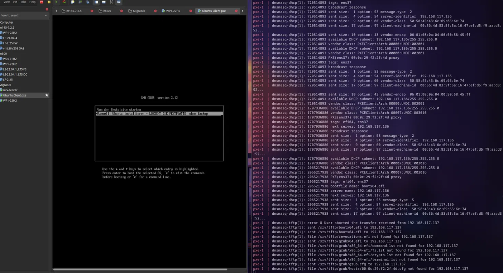
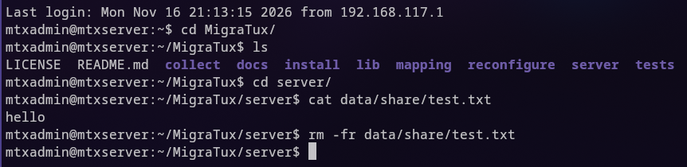

# M3 result, 2026-11-16

Guide: [M3-server-pxe.md](../M3-server-pxe.md) (test doc version 2026-11-11)

```
M3 test: OK
Date / tester: 2026-11-16 / arkaizn
Repo commit: 9b04813 Build samba and pxe images on Ubuntu, show build output when setup fails
VMs + OS build (winver / lsb_release -a), VMware version:
  mtx-server: Ubuntu Server 24.04, SERVER_IP 192.168.117.136 on ens37
  mtx-pxe:    empty VM, firmware BIOS in run 1, UEFI in run 2
  mtx-win:    Windows client, logged in as vmadmin (winver not noted)
  VMware Workstation (version not noted), all VMs on the 192.168.117.0/24 NAT net
Time taken: not noted (2 network boot runs)
Result per expected-result box: all six OK, see table below
Problem (if any): two tester-side problems, both solved and now in the guide:
  step 3, mtx-pxe was on BIOS firmware (see "Run 1");
  step 6, first net use failed with system error 86, wrong user typed (see "Share test").
```

## Result per expected-result box

| Box | Result | Note |
|---|---|---|
| Before you start: `setup.sh` ends with `setup: done`, three services are running | OK | |
| Step 1: the ISO answers with `200` | OK | `HTTP/1.1 200 OK` |
| Step 3: the PXE log shows `PXE` and `bootx64.efi`, then `sent` for `bootx64.efi`, `grubx64.efi`, `grub/grub.cfg` | OK | in run 2; run 1 failed, see below |
| Step 4: the MigraTux menu is visible, no install starts by itself | OK | in run 2 |
| Step 6: `net use` completes, `dir` lists `test.txt` | OK | second attempt; the first used the wrong user |
| Step 7: the file is on the server | OK | `cat` printed `hello`, file removed |

Step 8: `docker compose logs` saved to `~/m3-compose.log` on the server.

## Network boot, run 1: partial, `mtx-pxe` on BIOS firmware

- Proxy-DHCP worked: the client got `192.168.117.137` from VMware's DHCP server and found the proxy `192.168.117.136`.
- Then the VM stopped with:
  ```
  PXE-E76: Bad or missing multicast discovery address
  Operating System not found
  ```
- Cause: the VM firmware was BIOS. MigraTux only serves UEFI boot files.
- Fix: **VM → Settings → Options → Advanced → Firmware type: UEFI**. Now in the guide under "If it fails" and in [lab-setup.md](../../lab-setup.md).

## Network boot, run 2: OK, `mtx-pxe` on UEFI

PXE log (`docker compose logs -f pxe`):

- client architecture `efi64`, boot file `bootx64.efi`
- TFTP sent `bootx64.efi`, `grubx64.efi` and `grub/grub.cfg`
- `grub/hosts/<MAC>.cfg` not found: expected, there is no job for this PC, so no install starts
- harmless "not found" requests for `revocations.efi` and the `x86_64-efi/*.lst` files (shim and GRUB look for optional files)
- one `error 8 User aborted the transfer` on the first `bootx64.efi` request, then a clean resend (the firmware asks for the file size first, then loads it)

Screen of `mtx-pxe`:

- GRUB 2.12 menu with "Von der Festplatte starten" and "Manuell: Ubuntu installieren"
- no install started by itself



What this run shows: proxy-DHCP next to VMware's own DHCP server works, and shim and GRUB load over TFTP. That was the part of M3 that could not be tested without VMs.

## Share test (steps 5-7)

On `mtx-win`, logged in as `vmadmin`:

- First `net use \\192.168.117.136\migratux` failed with `Systemfehler 86`. Cause: the user `mtxadmin` was typed. That is `ADMIN_USER`, the Linux admin, not the share user.
- Second attempt with user `migratux` (`SMB_USER` from `server/.env`, password `SMB_PASSWORD`): the command completed successfully.
- `test.txt` written, `dir` lists it.


On `mtx-server`: `cat data/share/test.txt` printed `hello`. The file was removed afterwards.



The error 86 hint is now in the guide under "If it fails".

## Attachments

| File | Where |
|---|---|
| [m3/m3-grub-menu.png](m3/m3-grub-menu.png) (boot menu on `mtx-pxe`) | in the repo |
| [m3/m3-dir-output.png](m3/m3-dir-output.png) (`dir` output on `mtx-win`) | in the repo |
| [m3/m3-server-cat.png](m3/m3-server-cat.png) (`cat` on `mtx-server`) | in the repo |
| `m3-compose.log` | on the server at `~/m3-compose.log`, not copied into the repo yet |
| `setup.log` | on the server at `server/data/log/setup.log`, not copied into the repo yet |

Check both logs for passwords before they go into `m3/`.
